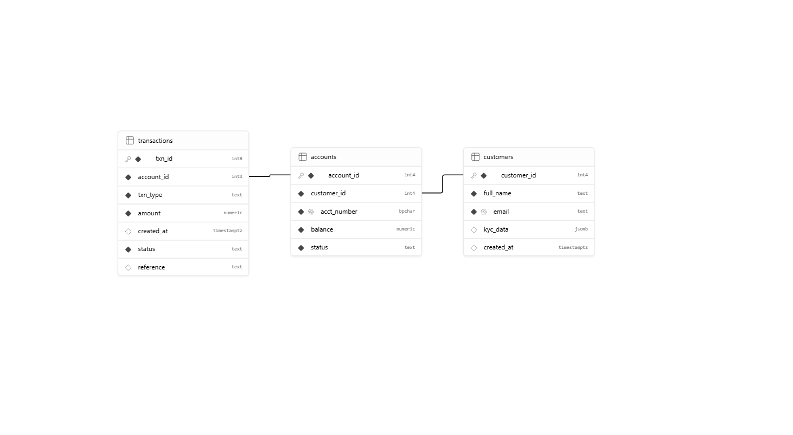

# Portfolio 1: Database Design and Modelling

**Course:** MIT 8103 Advanced Database Systems
**Platform used:** Supabase (PostgreSQL)

---

## 1. Case Study

**Organisation:** NovaBank, a simulated Nigerian fintech/bank.
**Nature of the system:** A retail banking platform for savings accounts, deposits, withdrawals and transfers.
**Users of the database:** Customers, tellers, and auditors.
**Major data stored:** Customers, accounts, and transactions.
**Key operations supported:** Open account, deposit, withdraw, transfer funds, reverse failed transactions, and audit account balances.

This same case study is used in all five portfolio activities.

---

## 2. Database Design

The design has three tables connected by one-to-many relationships:

- One **customer** can own many **accounts**.
- One **account** can have many **transactions**.



### Tables

| Table          | Purpose                                                                            |
| -------------- | ---------------------------------------------------------------------------------- |
| `customers`    | Stores customer identity and KYC details (`kyc_data` is JSONB for flexible data).  |
| `accounts`     | Stores each account, its unique account number, balance and status.                |
| `transactions` | Stores every money movement (deposit, withdrawal, transfer, reversal) as a ledger. |

The `status` and `reference` columns were added to `transactions` using `ALTER TABLE` so that failed transactions can be marked and reversed, and so every transaction can be audited.

The full script is in [`schema.sql`](schema.sql).

---

## 3. Keys and Constraints

| Table        | Primary Key | Foreign Key             | Constraints                                                                                                                     |
| ------------ | ----------- | ----------------------- | ------------------------------------------------------------------------------------------------------------------------------- |
| customers    | customer_id | none                    | `email` UNIQUE; `full_name` and `email` NOT NULL                                                                                |
| accounts     | account_id  | customer_id → customers | `acct_number` UNIQUE; `balance >= 0`; `status` in (active, frozen, closed)                                                      |
| transactions | txn_id      | account_id → accounts   | `amount > 0`; `txn_type` in (deposit, withdrawal, transfer_in, transfer_out, reversal); `status` in (success, failed, reversed) |

**Why these constraints matter for a bank:**

- The balance `CHECK` stops an account from going negative.
- The foreign keys stop an account or transaction from existing without its owner.
- The `amount > 0` check stops invalid or negative transactions being recorded.

---

## 4. Constraint Testing (Evidence)

I tested the constraints by deliberately inserting invalid data. The tests are in [`constraint-tests.sql`](constraint-tests.sql).

| Test | What I tried                                        | Result                                                                     | Evidence                               |
| ---- | --------------------------------------------------- | -------------------------------------------------------------------------- | -------------------------------------- |
| 4a   | Insert a valid customer (Ada Obi)                   | Success, 1 row inserted                                                    | n/a                                    |
| 4b   | Insert a second customer with the same email        | `ERROR 23505`: violates unique constraint `customers_email_key`            | `screenshots/02-unique-error.png`      |
| 4c   | Create an account for customer 999 (does not exist) | `ERROR 23503`: violates foreign key constraint `accounts_customer_id_fkey` | `screenshots/03-foreign-key-error.png` |
| 4d   | Create an account with balance -500                 | `ERROR 23514`: violates check constraint `accounts_balance_check`          | `screenshots/04-check-error.png`       |

The tables were also verified with a query on `information_schema.tables`, which lists `customers`, `accounts` and `transactions` (`screenshots/01-tables-verify.png`).

The errors are the expected outcome. They show that the database itself rejects invalid data, rather than relying on application code.

---

## 5. Normalisation

- **1NF:** Every column holds a single value and each table has a primary key. The `kyc_data` column is a deliberate JSONB exception, used for flexible, semi-structured data that is explored further in Portfolio 4.
- **2NF:** Every table uses a single-column primary key, so no non-key column can depend on only part of a key. There are no partial dependencies.
- **3NF:** No non-key column depends on another non-key column. Customer details are stored only in `customers`, and balances only in `accounts`, so nothing is repeated in the other tables.

**Before and after example:** Consider a single flat table with `full_name, email, acct_number, balance, txn_type, amount`. A customer's name and email would be repeated on every transaction row. Changing an email would need many updates (update anomaly), and a customer with no transactions could not be stored (insertion anomaly). Splitting the data into `customers`, `accounts` and `transactions` removes this redundancy and keeps each fact in one place.

---

## 6. Files in this Folder

```
portfolio-1-database-design/
├── schema.sql
├── constraint-tests.sql
├── er-diagram.png
├── screenshots/
│   ├── 01-tables-verify.png
│   ├── 02-unique-error.png
│   ├── 03-foreign-key-error.png
│   └── 04-check-error.png
└── README.md
```

## 7. How to Reproduce

1. Open the Supabase SQL Editor.
2. Run `schema.sql` to create the tables.
3. Run each statement in `constraint-tests.sql` one at a time and compare the results with Section 4.

---

## 8. Short Reflection

In this portfolio I designed the database for NovaBank, a simulated Nigerian fintech, using three tables: `customers`, `accounts` and `transactions`. I kept customer details, balances and the transaction ledger in separate tables so that each fact is stored in only one place, which satisfies third normal form and avoids update anomalies. I stored `kyc_data` as JSONB on purpose, because KYC information varies from customer to customer and this prepares the design for the NoSQL work in Portfolio 4.

I put the rules inside the database as constraints instead of relying on application code. For a bank this matters: the CHECK on `balance` stops an account from going negative, the foreign keys stop accounts or transactions from existing without an owner, and the UNIQUE constraint on `email` stops duplicate customers. I also added `status` and `reference` columns to `transactions` so that failed transactions can be marked and reversed, and every transaction can be audited.

A challenge I faced was when I ran my constraint tests and the SQL Editor showed red errors. At first I thought something had gone wrong, but I then understood that the errors were the expected result: each one (unique violation 23505, foreign key violation 23503 and check violation 23514) proved that the database rejects invalid data. I also learned to run each test one at a time, because a script stops at the first error.

The main lesson is that good design happens before any data is stored. Choosing the right keys and constraints early makes the database protect itself, and this design supports the later portfolios on queries, transactions and NoSQL.
